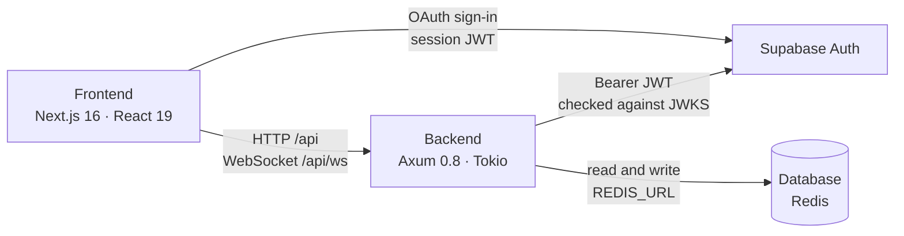
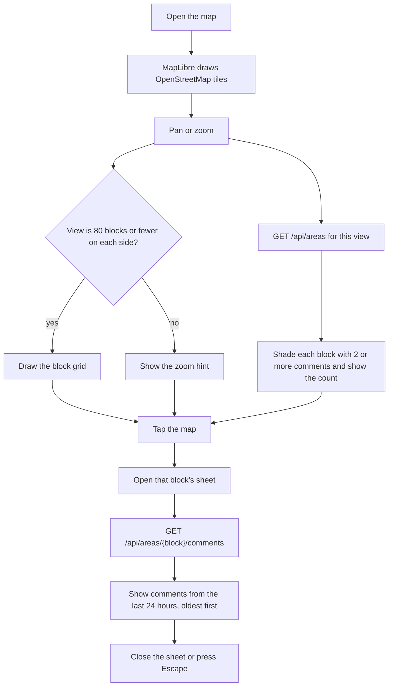
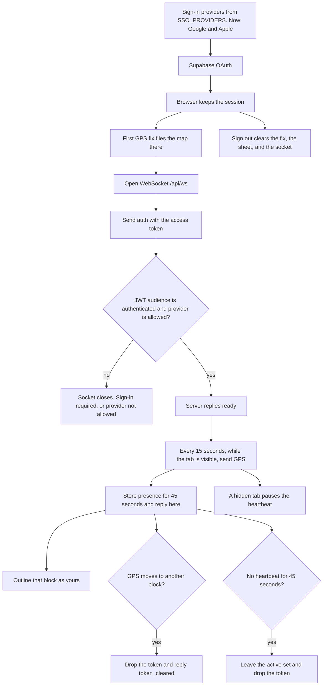
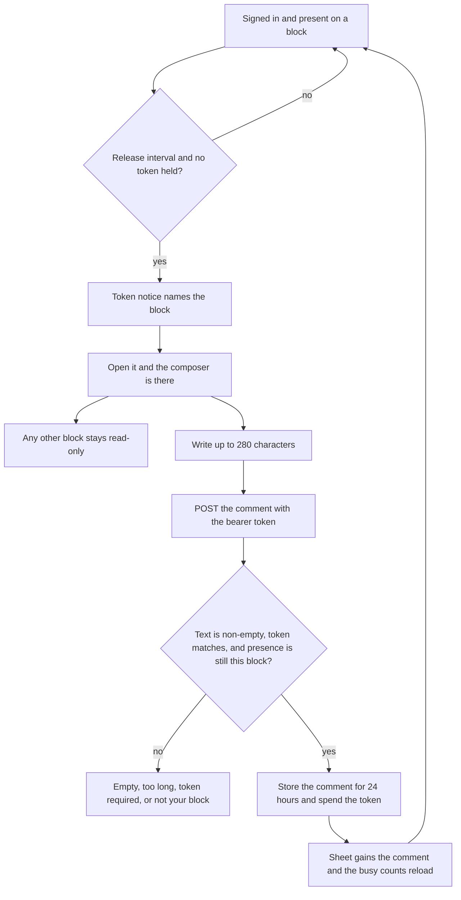
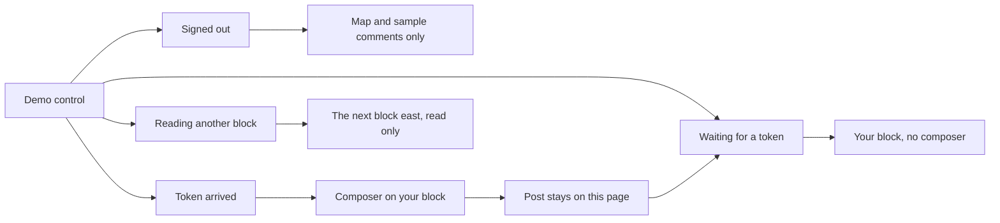

# 到此一遊

Map comments. The page is a Next.js app, the API is a Rust service, and the stored comments live in Redis. Sign-in is Supabase Auth: the page holds the session, and the API checks the token.

| Piece | What it is | Where |
| --- | --- | --- |
| Frontend | Next.js 16, React 19, Tailwind CSS 4 | `web/` |
| Backend | Axum 0.8 on Tokio | `server/` |
| Database | Redis (comments, presence, posting tokens) | `REDIS_URL` |
| Sign-in | Supabase Auth (OAuth session and JWKS) | browser and `server/` |

On Vercel, `/api` is rewritten to the Rust service and every other path goes to the Next.js app (`vercel.json`). Locally the page calls `NEXT_PUBLIC_API_URL` (for example `http://127.0.0.1:8787/api`) and the server listens on port 8787. See [web/README.md](web/README.md) for how to run each part.

## Grid size

The map is cut into square blocks of `AREA_STEP` degrees, `0.001` by default (about 110 metres). Raise it for fewer, larger blocks: `0.01` is about 1.1 km, so a whole neighborhood shares one conversation. `AREA_STEP` must stay between `0.0001` and `0.1`, and the server refuses to start otherwise.

The server owns the value. `GET /api/config` returns `{ "step": 0.01 }`, and the page draws the grid, snaps taps, and previews the GPS block with that number. Until the API answers, and on the static demo build with no API, the page uses `NEXT_PUBLIC_AREA_STEP`, then `0.001`. Leave `NEXT_PUBLIC_AREA_STEP` unset on a hosted build: the API value is the one that counts, and the build-time copy can only misplace the first paint.

Changing `AREA_STEP` starts a new grid. Comments, presence, and tokens are keyed by the old block ids, so notes written before the change stop appearing. They still expire on schedule. Flush the Redis database if the orphaned keys should go at once.

## Redis

One Redis database, `REDIS_URL`. Nothing is created ahead of time. The first write creates each key. `{user}` is the Supabase user id (`sub`). `{area}` is `floor(latitude / AREA_STEP):floor(longitude / AREA_STEP)`. `{id}` is a new UUID.

Two keys carry a Redis TTL. Redis deletes them when the time runs out. The others stay until the server removes them.

| Key | Type | Value | Redis TTL | Removed by the server |
| --- | --- | --- | --- | --- |
| `comment:{id}` | string | JSON `{ "text", "area", "created_at" }` | 86400 seconds | The index is removed when `expire` says this id is due, or when a list read finds the string missing or older than 24 hours. |
| `presence:{user}` | string | `{area}` from the latest heartbeat | 45 seconds | A new heartbeat replaces it. |
| `token:{user}` | string | `{area}` the token is for | none | Deleted when the comment is posted, the visitor moves to another block, or their `active` score is older than 45 seconds. |
| `active` | sorted set | member = `{user}`, score = heartbeat unix seconds | none | That member is `ZREM`ed when the score is older than 45 seconds. |
| `area:{area}` | sorted set | member = comment id, score = `created_at` unix seconds | none | `DEL`eted when `count:{area}` falls to 0. |
| `expire` | sorted set | member = `{area}\|{id}`, score = expiry unix time | none | `ZREM`ed when that comment is dropped. |
| `count:{area}` | integer | live comments in the block | none | `DEL`eted when it falls to 0. |
| `busy` | geo set | member = `{area}`, position = cell center | none | `ZREM`ed when the count falls below 2. |
| `waiting` | set | `{user}` present and without a token | none | `SREM`ed when a token is granted or the visitor goes stale. |

Anyone can read a block. `GET /api/areas/{area}/comments` does not check sign-in. The token is only for posting.

**Config.** `GET /api/config` returns `{ "step": 0.001 }`, the block size this server snaps with.

**Post.** One script, signed in, token required. The text must be non-empty and at most 280 characters. `GET token:{user}` and `GET presence:{user}` must both be this `{area}`. Then `SET comment:{id}` with `EX 86400`, `ZADD area:{area}` (score = unix seconds, member = `{id}`), `DEL token:{user}`, `ZADD expire` at `now + 86400`, and `INCR count:{area}`. When the count reaches 2, `GEOADD busy`. The event is the comment plus `count`.

**List.** `ZRANGE area:{area} 0 -1` returns the ids, oldest first. `GET comment:{id}` returns `{ "text", "area", "created_at" }`. A missing string, or JSON older than 24 hours, is removed with the same script as expiry. The response is `{ "comments": [ { "id", "text", "area", "created_at" } ] }`.

**Map counts.** `GET /api/areas` runs `GEOSEARCH busy` on the viewport, expanded by one cell, then `MGET count:{area}` for the members in that box. A block is in `busy` only while its count is at least 2. One comment is not filled on the map. Tapping that block still runs the list above.

**Sweep.** Every `TOKEN_RELEASE_SECS` (default 1), `ZRANGEBYSCORE expire -inf now`. Each due member decrements that block's count and leaves `busy` when the count falls below 2. A second with nothing due reads one empty range.

**Heartbeat.** `SET presence:{user} {area} EX 45` and `ZADD active` (score = now, member = `{user}`). `GET token:{user}`. When that value is a different block, `DEL token:{user}`. A visitor with no token is `SADD`ed to `waiting`. A visitor holding a token for this block is `SREM`ed from `waiting`. The socket reply is `{ "type": "here", "area", "token" }`. Restating the token there means a page hears about a grant even when the release push went to a different API process.

**Release.** On the same interval, `ZRANGEBYSCORE active -inf (now - 45)` finds stale visitors. Each is `ZREM`ed, their token is `DEL`eted, and they are `SREM`ed from `waiting`. `SMEMBERS waiting` is everyone still owed a token: `GET presence:{user}`, then `SET token:{user}` and `SREM waiting`.

**Socket open.** `GET token:{user}`. When the key is there, the server sends `{ "type": "token", "area" }` on that socket.

## How it works

The map is split into blocks of `AREA_STEP` degrees (about a city block at the `0.001` default). Anyone can read a block. A signed-in visitor can write on the block they are standing in, and only while they hold a token. A comment is at most 280 characters and lasts 24 hours. A block with two or more live comments is marked busy.

### Browse and read

With no API address, as on the GitHub Pages build, the map and the sheet still open. The list stays empty and nothing is posted.

### Sign in and stay on a block

### Token and a comment

Every `TOKEN_RELEASE_SECS` (default 1 second) the server walks everyone still active. Someone who does not already hold a token receives one, tied to the block in their latest presence.

A spent token, a move to another block, or a lapsed presence all return the visitor to waiting.

### Demo

`/demo`, or `?demo=1` on any page, walks the same screens without Supabase, GPS, or the API. The sample notes sit in the block under the map center and the two blocks north and east of it. A demo post stays in the browser and returns the control to waiting.

