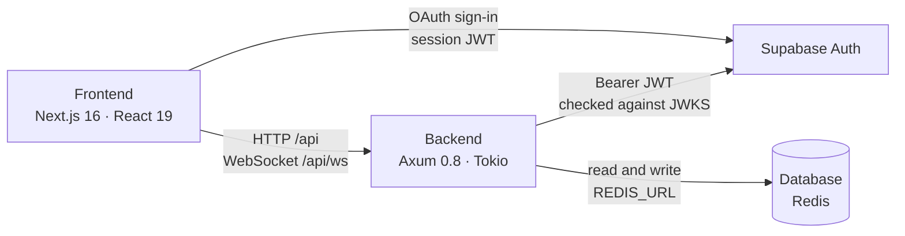
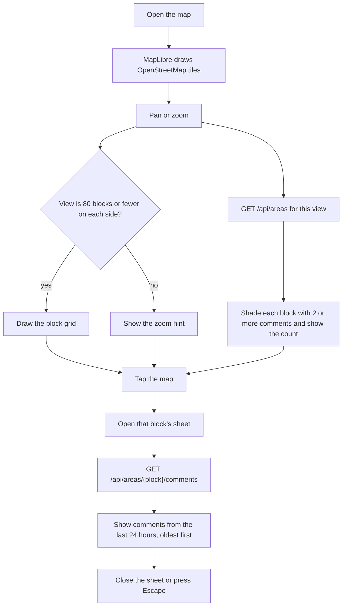
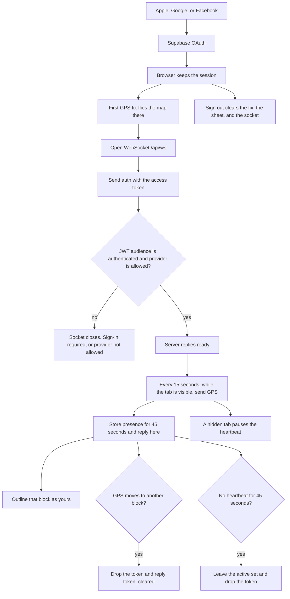
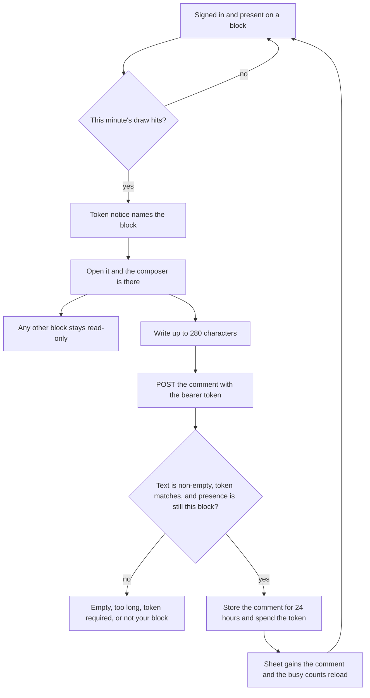
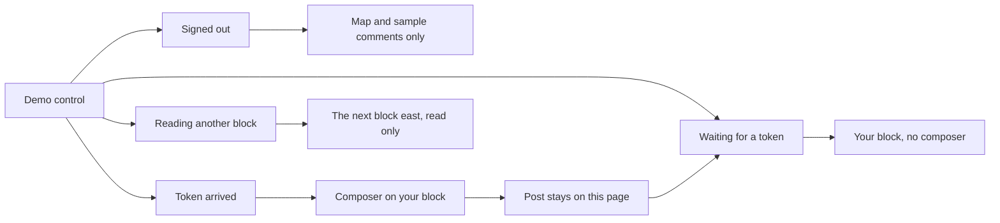

# 到此一遊

Map comments. The page is a Next.js app, the API is a Rust service, and the stored comments live in Redis. Sign-in is Supabase Auth: the page holds the session, and the API checks the token.

| Piece | What it is | Where |
| --- | --- | --- |
| Frontend | Next.js 16, React 19, Tailwind CSS 4 | `web/` |
| Backend | Axum 0.8 on Tokio | `server/` |
| Database | Redis (comments, presence, posting tokens) | `REDIS_URL` |
| Sign-in | Supabase Auth (OAuth session and JWKS) | browser and `server/` |

On Vercel, `/api` is rewritten to the Rust service and every other path goes to the Next.js app (`vercel.json`). Locally the page calls `NEXT_PUBLIC_API_URL` (for example `http://127.0.0.1:8787/api`) and the server listens on port 8787. See [web/README.md](web/README.md) for how to run each part.

## How it works

The map is split into blocks of `0.001°` (about a city block). Anyone can read a block. A signed-in visitor can write on the block they are standing in, and only while they hold a token. A comment lasts 24 hours. A block with two or more live comments is marked busy.

### Browse and read

With no API address, as on the GitHub Pages build, the map and the sheet still open. The list stays empty and nothing is posted.

### Sign in and stay on a block

### Token and a comment

Once a minute the server walks everyone still active. Someone who does not already hold a token is offered one about one time in four. The token is tied to the block in their latest presence.

A spent token, a move to another block, or a lapsed presence all return the visitor to waiting.

### Demo

`/demo`, or `?demo=1` on any page, walks the same screens without Supabase, GPS, or the API. The sample notes sit in the block under the map center and the two blocks north and east of it. A demo post stays in the browser and returns the control to waiting.

